# Архитектура «ДЕРЖИ ЛИНИЮ»

Правила партии отделены от Unity, ввода и графики. Поэтому оружие, волны и экономику можно проверять без сцены, а визуальное оформление менять без переписывания боя.

## Слои и зависимости

```mermaid
flowchart LR
    P[Presentation<br/>Ввод, HUD, отрисовка] --> A[Application<br/>Жизненный цикл, команды, настройки]
    A --> C[Core<br/>Состояние и правила партии]
    P -. типы и чтение состояния .-> C
    T[EditMode<br/>Контракты ядра] --> C
    I[PlayMode<br/>Ввод, часы, сцена] --> A
    I --> P
    V[Validation<br/>Повторяемый бой и Player probe] --> C
    V --> A
    V --> P
    E[Editor<br/>Сборка сцены и стресс-сценарий] --> P
    E --> A
    E --> C
```

Каждый основной слой имеет отдельный `.asmdef`. `Core` собирается с `noEngineReferences`: в нём нет `MonoBehaviour`, `GameObject`, `Transform`, `Time`, физики Unity или доступа к сцене. Команды проходят `Presentation → Application → Core`. Обратной зависимости от ядра к Unity нет. `Validation` — отдельная сборка сценария и измерителя, который включается только аргументом запуска Player.

| Каталог | Ответственность | Что сюда добавлять |
|---|---|---|
| `Core` | Состояние, команды строительства, экономика, движение, бой, волны, улучшения | Новые правила и данные симуляции |
| `Application` | Адаптация настроек Unity, создание партии, фиксированные шаги, управление паузой и скоростью | Связь жизненного цикла Unity с ядром |
| `Presentation` | Выбор инструмента, предварительная линия, русскоязычный HUD | Управление и отображение состояния |
| `Presentation/Rendering` | Тетрадь, постройки, враги и эффекты | Геометрия, материалы и визуальные обозначения |
| `Editor` | Создание готовой сцены, конфигурации, префаба и нагрузочного сценария | Инструменты разработки |
| `Tests` | Правила в EditMode, интеграция в PlayMode | Регрессии экономики, маршрутов, боя и мышиного ввода |

## Как проходит действие игрока

`Presentation.PaperDefenseBootstrap` собирает компоненты партии: контроллер, ввод, HUD и представление поля. Генератор `Editor.PaperDefenseSetup` сохраняет эту сборку как префаб и готовую сцену.

1. `DrawingInput` переводит положение мыши в клетки и собирает линию либо выбранную клетку. Пока игрок рисует, представление показывает предварительный результат.
2. `RunController` принимает команду: построить, стереть, улучшить, начать волну или выбрать улучшение.
3. Ядро проверяет доступность клетки, материал, состояние партии и стоимость. Только оно изменяет ресурсы и боевое состояние.
4. `NotebookHud` и `NotebookWorldView` читают полученное состояние. HUD объясняет результат команды, а графика показывает постройки, повреждения, врагов и выстрелы.

Экономику не следует дублировать в кнопках или рендерере. Отображаемая стоимость и фактическое списание должны исходить из одних правил ядра. Ошибки команд — обычный результат действия игрока, который приложение передаёт HUD.

## Время и данные

`RunController` скрывает изменяемый `GameSession` и выдаёт `IRunReadModel`. Его коллекции возвращают неизменяемые структуры значений `StructureView`, `EnemyView`, `ProjectileView`; параметры баланса также выдаются значениями. Получить исходный изменяемый список или состояние врага через этот интерфейс нельзя. Индексное чтение копирует одну запись, без копии орды и без выделения памяти. Итератор `foreach` создаёт небольшой объект; горячая отрисовка использует индексы. Коллекции живые: их читают в основном потоке между шагами. Хранить отдельное значение можно; перечислять коллекцию одновременно с шагом нельзя. Это контракт одного потока, без обещания потокобезопасности.

`FixedStepClock` выполняет симуляцию фиксированными шагами **1/30 секунды**. Ускорение ×2 увеличивает число таких шагов. За кадр выполняется не более шести шагов; избыток времени отбрасывается и учитывается в `DiscardedSimulationSeconds`. Неограниченного долга догоняющей симуляции нет. При перегрузке игра замедляется. Пауза очищает остаток времени, но команды интерфейса продолжают работать; поставленный чертёж оплачивается сразу, а его время строительства не идёт.

Порядок одного шага зафиксирован в `GameSession`: номер шага и время → сетка заполнения → доход → строительство, ожидание свободной клетки и перезарядки → переход фазы → появление врагов → одна перестройка общей карты при накопленных изменениях → движение и атаки врагов → прилёты ранее выпущенных снарядов → новые атаки башен → удаление погибших и награды → завершение волны. Изменения стены во время движения помечают карту для следующего шага; локальная проверка реальной постройки действует сразу.

`Application.GameBalanceAsset` — редактируемый `ScriptableObject`. При создании партии он преобразуется в обычные данные `Core.GameBalance`. Рабочее состояние партии не хранится в самом asset. Это отделяет баланс от изменяемых здоровья, ресурсов, перезарядок и текущей волны.

Материал постройки и тип оружия — разные параметры. Карандаш, ручка и фломастер применяются к одному семейству постройки. Переход материала сохраняет процент здоровья и добавляет фактически уплаченную разницу к `PaidInk`; стирание возвращает долю этих реальных вложений с учётом здоровья. Бесплатные стартовые укрепления не дают штрихов при стирании. Возврат незаконченного чертежа подчиняется тому же правилу материала.

Линия строительства дедуплицируется. Совпавшие сегменты стены или шипов того же материала пропускаются бесплатно; несовместимая клетка или недостаток средств отклоняют всю команду. Повтор полностью совпавшей линии — успешная операция с нулевой ценой. Предварительный расчёт не резервирует состояние: `TryBuild` повторяет проверку при выполнении. Незаконченные рисунки не стреляют и пропускают врагов. Блокирующий рисунок, время которого истекло под врагом, получает `WaitingForClearance` и завершается после освобождения клетки. Улучшение также временно переводит постройку в чертёж.

## Орда, путь и бой

Враги используют обратный Dijkstra. Стоимость клетки измеряется в секундах: время прохода плюс оценка пролома по текущему здоровью стены и урону в секунду. Здоровье округляется вверх до одного из четырёх диапазонов; отдельный удар внутри диапазона не вызывает перестройку. Пока все враги используют один профиль обычного противника. Отдельные карты появятся вместе с противниками, которым действительно нужны другие правила движения.

Накопленные изменения объединяются в одну перестройку на шаг. Замкнуть кольцо разрешено: пролом имеет конечную стоимость. Одновременно один сегмент атакуют три ближайших живых врага с устойчивым разрешением равенства по ID; перезарядка сохраняет место в переднем ряду. Мёртвые не занимают места следующего шага. `EnemyCrowdGrid` ограничивает заполнение клетки шестью врагами по умолчанию, удерживает очередь в соседних клетках и откладывает появление при занятой границе. Здесь нет попарного обхода всей орды. Это дискретная очередь с допустимым небольшим перекрытием рисунков, а не физическая симуляция толпы.

Пулемёт поражает отдельную цель, пробивающая пушка — линию. Мортира создаёт в ядре снаряд с сохранёнными координатами назначения, радиусом, уроном и временем полёта. Взрыв проверяет текущие позиции врагов в момент прилёта: быстрая цель может уйти. Продажа или разрушение башни не отменяет выпущенный снаряд. Волна ждёт оставшиеся снаряды. Рендерер рисует дугу и взрыв; расчёт урона полностью работает без сцены. `EnemySpatialIndex` проверен сравнением с полным перебором на случайных запросах, включая границы и погибшие цели.

`SimulationEventBuffer` — кольцо на 512 визуальных событий с монотонными `Sequence` и `Tick`. Запуск снаряда и его взрыв — разные события. Контроллер передаёт события после каждого выполненного шага, включая догоняющие шаги. Переполнение удаляет старые визуальные события и учитывается контроллером; оно не участвует в уроне, смерти или наградах. Представление отдельно ограничивает число активных эффектов 1024.

`NotebookWorldView` использует пять независимых mesh: бумага, неподвижные основания и стены, враги/поворотные части/строительство, эффекты, предварительная линия. Бумага обновляется при привязке карты; статические укрепления — по версиям изменений и диапазону повреждения базы; предварительная линия — при изменении её клеток или валидности. Динамические mesh обновляются по кадрам. Для врага не создаётся отдельный объект с `Update`, коллайдером и рендерером. Счётчики обновлений и измерение времени сборки mesh доступны измерителю.

`RunStatistics` хранит агрегаты: фактический урон по типам оружия, число атак, время без живой цели в радиусе, покупки по типу и материалу, вложения/улучшения/возвраты/потери, максимум живых врагов, выбранные улучшения и последние 32 разрушения с клеткой и временем. Урон ограничен оставшимся здоровьем цели. Простой считается суммой времени готовых живых орудий в боевой фазе без цели, включая их перезарядку; планирование и строительство исключены. Тайминги перестроек пути служат измерению и не входят в отпечаток состояния.

## Как расширять игру

### Новое оружие

1. Добавьте вид оружия и его данные в `Core`, определите стоимость, здоровье, дальность, перезарядку и геометрию поражения.
2. Расширьте обработку атаки в `Core/WeaponSystem.cs`. Геометрия и приоритеты целей отделены от `GameSession`, который управляет партией. Если нужен новый способ поиска целей, сохраните общие правила получения урона и смерти.
3. Добавьте редактируемые поля в `GameBalanceAsset` и их перенос в `GameBalance`.
4. Добавьте выбор инструмента, название, подсказку и рисунок в `Presentation`.
5. Проверьте отличающее новое правило тестом ядра: например, порядок пробитых целей или радиус взрыва.

Если меняются только числа существующего оружия, достаточно данных баланса. Новый тип поведения требует изменения ядра; каталог настроек сам по себе не создаёт новую механику.

### Новый враг

1. Добавьте тип и параметры в ядро: здоровье, скорость, урон, частоту атаки и награду.
2. Опишите отличие в выборе маршрута или атаке, если оно нужно. Обычные варианты с другими числами используют существующие правила.
3. Добавьте врага в состав волн и адаптер настроек.
4. Дайте ему читаемый силуэт в рендерере и название в информации о наступлении.
5. Проверьте особое поведение отдельно и затем в обычной волне с разрушением обороны.

### Волны, материалы и улучшения

Параметры существующих волн и построек меняйте через asset баланса. Для нового эффекта улучшения добавьте правило в ядро, данные в адаптер и текст выбора в HUD. Временные бонусы партии должны жить в состоянии партии, чтобы перезапуск создавал чистое состояние.

Изменение генератора `PaperDefenseSetup` влияет на вновь создаваемые объекты. При изменении структуры компонентов обновляйте одновременно генератор, префаб и сцену, затем проверяйте запуск с чистой сборкой сцены.

## Проверка и пределы прототипа

Тесты ядра должны проверять наблюдаемые правила: списание и возврат штрихов, стоимость перехода материала, разрешение замкнутой обороны и её пролом, поражение целей и переходы волн. Они не заменяют проверку привязок сцены, управления мышью, читаемости HUD и изображения в Play Mode.

`Validation.PressureScenario` использует обычные команды: замкнутый внешний контур, наступление с четырёх сторон, естественный пролом, строительство внутренних батарей во время боя и победа. Это явно выделенная нагрузочная конфигурация со своими ресурсами и скоростями; она не является балансом обычных восьми волн. Отчёт фиксирует seed, параметры, команды с номерами шагов, результат и отпечаток. Повторяемость ограничена той же версией кода и средой выполнения; межплатформенная детерминированность float и `System.Random` не обещана.

**Paper Defense → Проверить орду 3000** запускает этот сценарий без графики и сравнивает группировку шагов ×1/×2. Windows Player с `-paper-pressure -pressure-speed 1 -pressure-report <полный путь.json>` прогоняет тот же бой с реальной отрисовкой и обычными HUD/вводом; `-pressure-speed 2` проверяет ускорение. Измеритель сохраняет времена кадров, p95/p99, GC, расчёт шагов, перестройки пути и сборку mesh, тяжёлые кадры. Снимки во время измерения не создаются. В автоматическом прогоне не вводите дополнительные команды: совпадение результата проверяется по отпечатку. `Application` предоставляет только сборке `Validation` внутреннюю точку подключения сценария; доступ представления остаётся ограниченным. Результаты относятся к записанному компьютеру, разрешению и development-сборке.

Первый срез содержит одну карту и восемь волн, выбор из трёх улучшений между волнами, три оружия, стены, шипы, три материала и три роли врагов. Полный замысел шире: альбом карт, сохранение, постоянные открытия, новые семьи оружия и противников, развёрнутый разбор поражения и длительный режим пока остаются следующими этапами. Продолжительность партии и баланс требуют игровых тестов.
