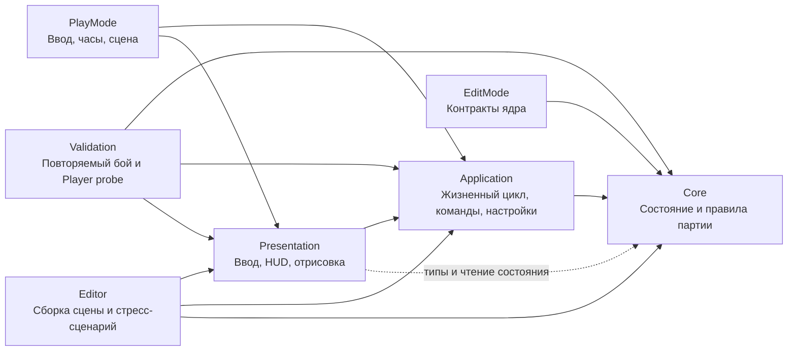

# Архитектура «ДЕРЖИ ЛИНИЮ»

Правила партии отделены от Unity, ввода и графики. Поэтому оружие, волны и экономику можно проверять без сцены, а визуальное оформление менять без переписывания боя.

Срез 12 октября добавляет мастерскую перед партией: неизменяемые сборки, постоянные открытия деталей, альбом, четыре выбранных чертежа и испытательный лист. Затем игра использует отдельные ресурсы партии, цветные чернильницы, кляксы и дальнобойных противников. [Управление и игровой цикл](Workshop-Guide.md).

Расширение авторского альбома разделяет конструкцию и её исполнение. `TowerBlueprint` неизменяемо хранит обе части и вычисленный `DrawingAssessment`. Новый черновик создаётся через `NewDraft`: пустой авторский рисунок нельзя сохранить как законченную страницу. Старые страницы имеют явный `LegacyStandard` и сохраняют прежнюю эффективность.

## Путь авторского рисунка

`DrawingSnapshot` формата2 владеет нормализованными штрихами восьми устойчивых частей: основание, два крепления, броня, подача, наведение, декор6 и направляющая7. Строгий формат1 с ключами0–6 мигрирует с пустой направляющей; старые координаты и binding1 не меняются. Вложенные коллекции неизменяемы. `DrawingEditSession` выполняет рисование, удаление штриха, очистку, undo/redo с ограниченной историей. Замена детали очищает только её исполнение. Неактивные части сохраняются при чтении, но не влияют на оценку и не отображаются как установленное оборудование.

`DrawingTemplateCatalog` задаёт бледные контуры и локальные pivots. `DrawingEvaluator` сравнивает объединения линий на сетке128² с допуском .06, сочетая полноту и точность. Дубликаты не накапливают баллы, вес детали не зависит от числа точек, декор имеет нулевой вес. Версия алгоритма, геометрия, происхождение и конструкция образуют ключ ограниченного кэша. Оценка вычисляется при изменении страницы, вне боевого шага. `TowerCatalog` применяет коэффициент качества один раз к конечному темпу после подачи; прочие характеристики и цвет от него не зависят.

`DrawingPartPolicy` задаёт общую активность частей и сохранение линий при смене сборки. Её используют шаблоны, `TowerBlueprint.WithAssembly` и `DrawingEditSession`. Замена основания или крепления очищает только соответствующую часть; модуль сохраняет линии, если установлен до и после изменения; декор сохраняется. Точная замена на ту же сборку оставляет и неактивные данные. Сессия редактора применяет политику к своему текущему рисунку, включая ещё не применённые штрихи; undo/redo остаётся операцией редактора.

Presentation использует один `DrawingCanvasGraphic` для ввода и отображения всего рисунка. Ввод ограничен видимым RectTransform; выход завершает штрих, возвращение начинает следующий. Отмена закрывает частную рабочую копию; Apply переносит её в черновик, а запись в альбом остаётся отдельной транзакцией. `AuthoredGeometryCache` подготавливает локальные quads по версии/хэшу рисунка и переиспользует их между экземплярами. `MeshPen.Append` только жёстко переносит/поворачивает их. У каждой башни отдельно живут HP, cooldown и цели; у каждого ствола — собственные `PrimaryAim`/`SecondaryAim`. Рендерер не заменяет линии аккуратным силуэтом и не добавляет новую случайную деформацию копиям.

## Профиль и граница записи

`WorkshopProfile` содержит золото, вечные открытия, альбом и четыре ID выбранных страниц. `CreateWorkingCopy` точно копирует состояние без нормализации загрузчика и восстановления стартовых страниц. Application `WorkshopProfileStore` единолично выполняет IO через внедряемый `IWorkshopProfileIO`. Результат чтения различает новый профиль, primary, backup и `RecoveryRequired`; отказ доступа и будущая версия защищают источник от записи. Повреждённый primary сохраняется отдельно, хороший backup остаётся восстанавливаемым. Кандидат сериализуется, проверяется и перечитывается до атомарного commit.

Save/Delete/Assign/Unlock публикуют кандидата лишь после успешной записи. Награда завершённой волны сначала начисляется один раз в памяти; отказ IO оставляет dirty-состояние, повтор записи не повторяет начисление. `ProfileSaveState`, сообщение и наличие несохранённых изменений доступны HUD. Это сохранение профиля, а не незаконченного боя; аварийное завершение не гарантирует сохранность dirty-награды.

Профиль версии3 сохраняет исходные байты v1/v2 в `.v1-original`/`.v2-original` перед первой записью миграции. Чтение само не переписывает файлы. Неизвестная версия профиля/рисунка, право, вид детали или бит модуля защищают источник и запрещают откат к старому backup. Лимит UTF-8 в32MiB одинаков для чтения и записи и проверен полным альбомом64×2048 точек. Настоящий профиль не используется в тестах. Флаги `-paper-memory-only` и `-paper-pressure` отключают profile IO до инициализации мастерской.

`ProfileLimits` хранит структурные пределы: 64 страницы, 4 выбранных ID, 64 знака ID и 48 знаков имени. Ограничения рисунка принадлежат `DrawingSnapshot`, точность координат — `DrawingPoint`, предел JSON — `WorkshopProfileStore`. Они не зависят от текущей вместимости основания или настроек боя.

## Общие настройки

`GameBalance` содержит определения оружия/материалов/врагов/волн и наборы правил `Construction`, `Effects`, `Progression`. `CreateSnapshot` глубоко копирует их на границе владения. `PartCatalog` содержит устойчивые ID деталей, роли, имена, подписи, описания и доступность в историческом формате. Числовые цены, нагрузки и параметры открытия остаются в определениях и `Construction`; каталог не хранит их вторую копию. `PartUnlock` — совместимое представление права и цены, полученное из каталога и актуальных правил.

Путь Unity-конфигурации:

1. `GameBalanceAsset.CreateBalance`: defaults → снимки `Construction`/`Effects`/`Progression` → конечные Inspector-поля и определения с прежними ограничениями.
2. `CreateWorkshopBalance`: полученный баланс → параметры мастерской → необязательная генерация угроз → необязательное преобразование Target.
3. `BalanceValidation` проверяет конечность, диапазоны, полноту и известные виды определений на границе адаптации, создания `GameSession` и запуска полигона. Проверка не нормализует конфигурацию и не заменяет прежние защитные ограничения симуляции.

Отсутствующие или пустые массивы Inspector наследуют defaults; повторные настройки одного вида применяются по порядку, последняя имеет приоритет. Target переопределяет только свои параметры; явная выплата волны `InkGrant >= 0` сохраняется. Без asset обычный запуск использует исторические defaults, мастерская — целевой пресет.

`RunController` передаёт партии свежий баланс, созданный адаптером или пресетом, поэтому изменение исходного asset не меняет начатый бой. Прямой `GameSession(balance)` проверяет и принимает переданный объект, сохраняя прежний контракт владения: вызывающий код не должен менять его во время партии. `TrialRunner` проверяет и копирует явно переданный актуальный баланс; глубокие копии не создаются при обновлении HUD или каждом шаге.

`TowerCatalog` обслуживает preview, стоимость размещения, списание и полигон. `ToolCost` сохраняет историческое выражение цены отдельного инструмента; `GameBalanceView.ToolCost` передаёт его HUD. Цена составной башни остаётся отдельным расчётом `Cost` с прежними типами и порядком операций. Загрузчик отделяет структурную корректность страницы от текущего лимита нагрузки: изменение баланса не удаляет старую работу.

`TrialScenarioDefinition` хранит состав полосы, HP, скорость, шаг, предел длительности и параметры ответного огня. Позиции и конечные кляксы задаёт сценарий `TrialRunner`; это отдельные условия испытания. Оружие использует общие правила партии. Сравнение качества меняет только оценку одной сборки с той же геометрией. [Словарь параметров](Balance-Parameters.md) описывает единицы, формулы и потребителей.

| Вид данных | Где находится | Граница ответственности |
|---|---|---|
| Определения | `GameBalance`, `PartCatalog`, наборы правил | Возможности и параметры; не меняются во время партии |
| Состояние экземпляра | `StructureState`, `EnemyState`, снаряды, статусы | HP, таймеры, цели, бюджет цвета и фактические вложения |
| Сохранённая работа | `TowerBlueprint`, `DrawingSnapshot`, `WorkshopProfile` | Конструкция, авторские линии, права и выбранные страницы |
| DTO | `WorkshopProfileData`, `BlueprintData`, `DrawingData` и вложенные типы | Версионное представление; явные преобразования у границы записи |
| Read model | `IRunReadModel`, `GameBalanceView`, `WorkshopReadModel` | Ограниченное чтение для интерфейса без изменяемых коллекций |
| Результат операции | `BuildQuote`, `ProfileLoadResult`, `ProfileSaveResult` | Данные, исход и диагностика команды |

Публичные DTO остаются в существующей сборке Core ради совместимости типов и сериализации. Они не выполняют IO и не становятся живым боевым состоянием. `WorkshopProfileStore` координирует сериализацию и запись, а `CreateWorkingCopy` копирует профиль без загрузочной нормализации.

## Слои и зависимости

Каждый основной слой имеет отдельный `.asmdef`. `Core` собирается с `noEngineReferences`: в нём нет `MonoBehaviour`, `GameObject`, `Transform`, `Time`, физики Unity или доступа к сцене. Команды проходят `Presentation → Application → Core`. Обратной зависимости от ядра к Unity нет. `Validation` — отдельная сборка сценария и измерителя, который включается только аргументом запуска Player.

| Каталог | Ответственность | Что сюда добавлять |
|---|---|---|
| `Core` | Состояние, команды строительства, экономика, движение, бой, волны, улучшения | Новые правила и данные симуляции |
| `Application` | Адаптация настроек Unity, создание партии, фиксированные шаги, управление паузой и скоростью | Связь жизненного цикла Unity с ядром |
| `Presentation` | Выбор инструмента, предварительная линия, русскоязычный HUD | Управление и отображение состояния |
| `Presentation/Rendering` | Тетрадь, постройки, враги и эффекты | Геометрия, материалы и визуальные обозначения |
| `Editor` | Создание готовой сцены, конфигурации, префаба и нагрузочного сценария | Инструменты разработки |
| `Tests` | Правила в EditMode, интеграция в PlayMode | Регрессии экономики, маршрутов, боя и мышиного ввода |

## Как проходит действие игрока

`Presentation.PaperDefenseBootstrap` собирает компоненты партии: контроллер, ввод, HUD и представление поля. Генератор `Editor.PaperDefenseSetup` сохраняет эту сборку как префаб и готовую сцену.

1. `DrawingInput` переводит положение мыши в клетки и собирает линию либо выбранную клетку. Пока игрок рисует, представление показывает предварительный результат.
2. `RunController` принимает команду: построить, стереть, улучшить, начать волну или выбрать улучшение.
3. Ядро проверяет доступность клетки, материал, состояние партии и стоимость. Только оно изменяет ресурсы и боевое состояние.
4. `NotebookHud` и `NotebookWorldView` читают полученное состояние. HUD объясняет результат команды, а графика показывает постройки, повреждения, врагов и выстрелы.

Экономику не следует дублировать в кнопках или рендерере. Отображаемая стоимость и фактическое списание должны исходить из одних правил ядра. Ошибки команд — обычный результат действия игрока, который приложение передаёт HUD.

## Время и данные

`RunController` скрывает изменяемый `GameSession` и выдаёт `IRunReadModel`. Его коллекции возвращают неизменяемые структуры значений `StructureView`, `EnemyView`, `ProjectileView`; параметры баланса также выдаются значениями. Получить исходный изменяемый список или состояние врага через этот интерфейс нельзя. Индексное чтение копирует одну запись, без копии орды и без выделения памяти. Итератор `foreach` создаёт небольшой объект; горячая отрисовка использует индексы. Коллекции живые: их читают в основном потоке между шагами. Хранить отдельное значение можно; перечислять коллекцию одновременно с шагом нельзя. Это контракт одного потока, без обещания потокобезопасности.

`FixedStepClock` выполняет симуляцию фиксированными шагами **1/30 секунды**. Ускорение ×2 увеличивает число таких шагов. За кадр выполняется не более шести шагов; избыток времени отбрасывается и учитывается в `DiscardedSimulationSeconds`. Неограниченного долга догоняющей симуляции нет. При перегрузке игра замедляется. Пауза очищает остаток времени, но команды интерфейса продолжают работать; поставленный чертёж оплачивается сразу, а его время строительства не идёт.

Порядок одного шага зафиксирован в `GameSession`: номер шага и время → временные эффекты, поглощение/высыхание клякс и полёт вражеских сгустков → сетка заполнения → доход → строительство, ожидание свободной клетки и перезарядки → переход фазы → появление врагов → перестройка общих карт при накопленных изменениях → движение и атаки врагов → прилёты мортир → новые атаки башен → удаление погибших и награды → завершение волны. Изменения стены во время движения помечают карту для следующего шага; локальная проверка реальной постройки действует сразу.

`Application.GameBalanceAsset` — редактируемый `ScriptableObject`. При создании партии он преобразуется в обычные данные `Core.GameBalance`. Рабочее состояние партии не хранится в самом asset. Это отделяет баланс от изменяемых здоровья, ресурсов, перезарядок и текущей волны.

Материал постройки и тип оружия — разные параметры. Карандаш, ручка и фломастер применяются к одному семейству постройки. Переход материала сохраняет процент здоровья и добавляет фактически уплаченную разницу к `PaidInk`; стирание возвращает долю этих реальных вложений с учётом здоровья. Бесплатные стартовые укрепления не дают штрихов при стирании. Возврат незаконченного чертежа подчиняется тому же правилу материала.

Линия строительства дедуплицируется. Совпавшие сегменты стены или шипов того же материала пропускаются бесплатно; несовместимая клетка или недостаток средств отклоняют всю команду. Повтор полностью совпавшей линии — успешная операция с нулевой ценой. Предварительный расчёт не резервирует состояние: `TryBuild` повторяет проверку при выполнении. Незаконченные рисунки не стреляют и пропускают врагов. Блокирующий рисунок, время которого истекло под врагом, получает `WaitingForClearance` и завершается после освобождения клетки. Улучшение также временно переводит постройку в чертёж.

## Орда, путь и бой

Враги используют обратный Dijkstra. Стоимость клетки измеряется в секундах: время прохода плюс оценка пролома по текущему здоровью стены и урону в секунду. Здоровье округляется вверх до одного из четырёх диапазонов; отдельный удар внутри диапазона не вызывает перестройку. Один профиль обычного противника обслуживает до четырёх общих карт: обязательную базу и активные чернильницы. Врагу назначается цель при появлении; после потери точки он идёт к базе. Индивидуальных поисков пути нет.

Накопленные изменения объединяются в одну перестройку на шаг. Замкнуть кольцо разрешено: пролом имеет конечную стоимость. Одновременно один сегмент атакуют три ближайших живых врага с устойчивым разрешением равенства по ID; перезарядка сохраняет место в переднем ряду. Мёртвые не занимают места следующего шага. `EnemyCrowdGrid` ограничивает заполнение клетки шестью врагами по умолчанию, удерживает очередь в соседних клетках и откладывает появление при занятой границе. Здесь нет попарного обхода всей орды. Это дискретная очередь с допустимым небольшим перекрытием рисунков, а не физическая симуляция толпы.

Пулемёт поражает отдельную цель, пробивающая пушка — линию. Мортира создаёт в ядре снаряд с сохранёнными координатами назначения, радиусом, уроном и временем полёта. Взрыв проверяет текущие позиции врагов в момент прилёта: быстрая цель может уйти. Продажа или разрушение башни не отменяет выпущенный снаряд. Волна ждёт оставшиеся снаряды. Рендерер рисует дугу и взрыв; расчёт урона полностью работает без сцены. `EnemySpatialIndex` проверен сравнением с полным перебором на случайных запросах, включая границы и погибшие цели.

`WeaponSystem` координирует выбор цели и действие крепления. Общие `MountRange`, `TryBeginAction`, применение попадания и `PublishShot` обслуживают специализированные формы поражения. Запуск мортиры и её попадание остаются разными этапами. Очистка клякс использует общие подачу, интервал и публикацию видимого действия, но отдельно считает очищенные пятна и не наносит урон врагу.

`SimulationEventBuffer` — кольцо на 512 визуальных событий с монотонными `Sequence` и `Tick`. Запуск снаряда и его взрыв — разные события. Контроллер передаёт события после каждого выполненного шага, включая догоняющие шаги. Переполнение удаляет старые визуальные события и учитывается контроллером; оно не участвует в уроне, смерти или наградах. Представление отдельно ограничивает число активных эффектов 1024.

`NotebookWorldView` использует пять независимых mesh: бумага, неподвижные основания и стены, враги/поворотные части/строительство, эффекты, предварительная линия. Бумага обновляется при привязке карты; статические укрепления — по версиям изменений и диапазону повреждения базы; предварительная линия — при изменении её клеток или валидности. Динамические mesh обновляются по кадрам. Для врага не создаётся отдельный объект с `Update`, коллайдером и рендерером. Счётчики обновлений и измерение времени сборки mesh доступны измерителю.

`RunStatistics` хранит агрегаты: фактический урон по типам оружия, число атак, время без живой цели в радиусе, покупки по типу и материалу, вложения/улучшения/возвраты/потери, максимум живых врагов, выбранные улучшения и последние 32 разрушения с клеткой и временем. Урон ограничен оставшимся здоровьем цели. Простой считается суммой времени готовых живых орудий в боевой фазе без цели, включая их перезарядку; планирование и строительство исключены. Тайминги перестроек пути служат измерению и не входят в отпечаток состояния.

## Как расширять игру

### Мастерская, сохранения и новые детали

`TowerBlueprint` — неизменяемое значение сборки: ID, имя, основание, два крепления и флаги уникальных модулей. `TowerCatalog` централизует нагрузку, ограничения, цену, прочность основания, время, подачу и стоимость картриджа. `WeaponSystem` обрабатывает крепления с отдельными перезарядками и общей подачей. Материал умножает параметры конструкции; один цвет действует на все её орудия и сохраняется в выпущенной мортире.

`WorkshopProfile` хранит золото, постоянные права на детали, до 64 сборок и четыре выбранных ID. Детали не являются расходуемыми экземплярами. `WorkshopPersistence` сериализует только версионный DTO профиля: временный файл → атомарная замена → резервная копия. Состояния орды, базы и чернильниц туда не попадают. `RunController` переносит отдельный снимок четырёх чертежей в новую партию, запрещает редактирование мастерской во время боя и зачисляет только новую разницу `GoldEarned`. Обычная команда `Build` в этом режиме принимает стены и шипы; башни проходят через выбранный слот.

`WorkshopReadModel` выдаёт только чтение неизменяемых объектов и коллекций. `TrialRunner` не связан с профилем: конечный поток врагов обрабатывает настоящая система оружия; результат содержит ограниченную запись кадров из структур значений. Копирование происходит только по кнопке испытания, вне партии. Полигон намеренно использует готовые карандашные башни, фиксированное размещение и упрощённый ответный огонь; эти условия видны игроку.

`GameSession.Construction` отвечает за расчёт и атомарное строительство сборки, окраску и параметры перехода материала. `GameSession.Objectives` — за цели, поля маршрутов, захват, потерю и выдачу цвета. `GameSession.Enemies` — за кляксы, подготовку выстрела и прямые сгустки. `EnemyEffects` — за ограниченные статусы и получение урона. Временные цвета работают независимо от флага, отключающего новых врагов и кляксы.

Порядок расширения деталей и эффектов описан в [короткой инструкции](Extending-Mechanics.md). Сборка на поле остаётся неизменяемой. Чтобы добавить цель, расширяйте список общих полей по целям; не создавайте поиск пути на каждого врага. Новые кольца событий и записи должны иметь явный предел хранения.

### Новое оружие

`GameBalancePresets` создаёт отдельный целевой снимок из исторической конфигурации. `TargetPresetSettings` задаёт конечную экономику и гипотезы перебалансировки; исходный asset не меняется. Сцена ссылается через существующий префаб на `TargetNotebookBalance`, исторический `NotebookBalance` остаётся источником сравнений. `WaveDefinition.InkGrant=-1` означает общую выплату, а явно заданная выплата сохраняется.

`EnemyRewardBudget` закрепляет награду при спавне и разрешает расходовать её один раз. Перенос части бюджета возможному дочернему врагу сохраняет общую сумму. Источник дохода не зависит от числа трупов или времени ожидания. `DamageRules` использует одну ограниченную защиту для врагов, построек, прямых сгустков и ответного огня полигона. Красное горение имеет явный переключатель игнорирования защиты.

Динамическая подача считает только крепления с подходящей целью. Каждое хранит конечный остаток действия вместо неограниченного накопления залпов. `TowerColorBudget` принадлежит экземпляру башни и разделяется её стволами и запущенными снарядами; пропуск цветового эффекта не отменяет обычный урон. `ColorEffectPayload` фиксирует параметры в момент запуска. `TimedEffectState` хранит ограниченный набор независимых сил и сроков: слабое воздействие не продлевает сильное.

Числовые значения сохранённых enum закреплены явно; новые значения не переиспользуют старые номера. Плотный диапазон видов используется статистикой и закрепляется отдельным контрактом. `PartCatalog` задаёт допустимость крепления и вечное право, `Construction` — нагрузку и цену, а `DrawingTemplateCatalog` — самостоятельный локальный образец. Исходные авторские линии остаются неизменяемыми; рендерер поворачивает их вокруг каждого крепления. Неизвестные права и детали в профиле версии3 защищают файл от записи и отката к старому backup.

`IBlotContext` отделяет поиск и очистку клякс от конкретного поля. Обычная партия и конечный сценарий полигона предоставляют свои адаптеры; автоматический промокатель использует общие подачу, качество и интервал, действует без врагов и не расходует цветовой бюджет урона. Направляющая меняет дальность через `TowerCatalog.WeaponRange`, а интервал — через `TowerCatalog.ActionInterval`; эти же функции используют полигон, preview и подсказка дальности.

`DrawingSnapshot` хранит восемь частей формата2; строгий формат1 с семью частями мигрирует добавлением пустой направляющей. Привязки остаются версии1. `DrawingAssessment` вычисляет умеренный коэффициент исполнения, а `AuthoredGeometryCache` разделяет подготовленные линии между копиями. Здоровье, цели, перезарядки и цветовой бюджет принадлежат каждому экземпляру отдельно.

Если меняются только числа существующего оружия, достаточно данных баланса. Новый тип поведения требует изменения ядра; каталог настроек сам по себе не создаёт новую механику.

### Новый враг

1. Добавьте тип и параметры в ядро: здоровье, скорость, урон, частоту атаки и награду.
2. Опишите отличие в выборе маршрута или атаке, если оно нужно. Обычные варианты с другими числами используют существующие правила.
3. Добавьте врага в состав волн и адаптер настроек.
4. Дайте ему читаемый силуэт в рендерере и название в информации о наступлении.
5. Проверьте особое поведение отдельно и затем в обычной волне с разрушением обороны.

### Волны, материалы и улучшения

Параметры существующих волн и построек меняйте через asset баланса. Для нового эффекта улучшения добавьте правило в ядро, данные в адаптер и текст выбора в HUD. Временные бонусы партии должны жить в состоянии партии, чтобы перезапуск создавал чистое состояние.

Изменение генератора `PaperDefenseSetup` влияет на вновь создаваемые объекты. При изменении структуры компонентов обновляйте одновременно генератор, префаб и сцену, затем проверяйте запуск с чистой сборкой сцены.

## Проверка и пределы прототипа

Тесты ядра должны проверять наблюдаемые правила: списание и возврат штрихов, стоимость перехода материала, разрешение замкнутой обороны и её пролом, поражение целей и переходы волн. Они не заменяют проверку привязок сцены, управления мышью, читаемости HUD и изображения в Play Mode.

`Validation.PressureScenario` использует обычные команды: замкнутый внешний контур, наступление с четырёх сторон, естественный пролом, строительство внутренних батарей во время боя и победа. Это явно выделенная нагрузочная конфигурация со своими ресурсами и скоростями; она не является балансом обычных восьми волн. Отчёт фиксирует seed, параметры, команды с номерами шагов, результат и отпечаток. Повторяемость ограничена той же версией кода и средой выполнения; межплатформенная детерминированность float и `System.Random` не обещана.

**Paper Defense → Проверить орду 3000** запускает этот сценарий без графики и сравнивает группировку шагов ×1/×2. Windows Player с `-paper-pressure -pressure-speed 1 -pressure-report <полный путь.json>` прогоняет тот же бой с реальной отрисовкой и обычными HUD/вводом; `-pressure-speed 2` проверяет ускорение. Измеритель сохраняет времена кадров, p95/p99, GC, расчёт шагов, перестройки пути и сборку mesh, тяжёлые кадры. Снимки во время измерения не создаются. В автоматическом прогоне не вводите дополнительные команды: совпадение результата проверяется по отпечатку. `Application` предоставляет только сборке `Validation` внутреннюю точку подключения сценария; доступ представления остаётся ограниченным. Результаты относятся к записанному компьютеру, разрешению и development-сборке.

Текущий срез содержит одну карту, восемь волн, улучшения после волн2/4/6, семь функциональных деталей, четыре модуля, стены/шипы, три материала и четыре роли врагов. Мастерская, авторские страницы и постоянные открытия связаны с боем, чернильницами, кляксами и полигоном. Дополнительные карты, звук, длительный режим и сохранение незаконченного боя остаются вне среза. Продолжительность партии и баланс требуют игровых тестов.
