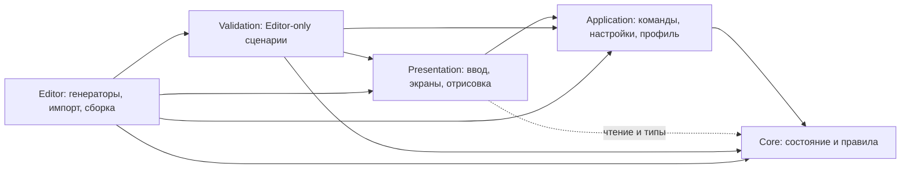

# Архитектура «ДЕРЖИ ЛИНИЮ»

> Техническая база до перехода. Свободное рисование отменено в целевом дизайне; упоминания Drawing/Freeform ниже описывают ещё существующий код и совместимость. Новые правила: [конструктор](Workshop-Assembly.md), [характеристики](Component-Stats-and-Abilities.md), [план перехода](superpowers/plans/2026-10-18-modular-album-implementation.md).

Техническая справка по действующим системам игры. [Эскизы и целевой дизайн](Game-Design.md) задают визуальный ориентир; [статус переноса в Unity](superpowers/plans/2026-10-18-modular-album-implementation.md) отделяет реализованные экраны от оставшейся работы.

[Указатель документации](README.md) · [Действующие механики](Current-Mechanics.md) · [Разработка и проверки](Development-Guide.md)

Правила партии отделены от Unity, ввода, графики и файлов. Оружие, волны, строительство и экономику можно проверять без сцены; интерфейс обращается к командам Application и читает ограниченные представления состояния.

## Слои и зависимости

Каждый слой имеет отдельный `.asmdef`. [Core](../Assets/PaperDefense/Core/PaperDefense.Core.asmdef) собирается с `noEngineReferences`: в нём нет MonoBehaviour, сцены, физики Unity или файлового IO. DTO исторически остаются в Core ради совместимости типов, но не становятся живым состоянием боя.

| Слой | Ответственность |
|---|---|
| Core | Модели, правила, геометрия, симуляция, неизменяемые определения и DTO |
| Application | RunController, снимки настроек Unity, фиксированные часы, команды, профиль и запись |
| Presentation/Player | Игровые страницы, подготовка, пауза, результат и собственный HUD |
| Presentation/UI, Input | Мастерская, редактор, полигон, общий HUD и жесты |
| Presentation/Rendering, Art | Пакетные mesh, события, анимация и повтор полигона |
| Validation | Editor-only fixtures, давление 3000, числовой баланс и приёмка данных |
| Editor | Открытие/создание сцен, импорт графики, экспорт данных и сборка Player |

## Входы и жизненный цикл

Игровая [PaperDefenseGame.unity](../Assets/PaperDefense/Scenes/Game/PaperDefenseGame.unity) содержит `PlayerGameRoot`. Он создаёт `PaperDefenseBootstrap` под неактивным корнем, назначает PlayerBalance, текст и камеру до Awake, отключает технические HUD и создаёт `PlayerShell`, `PlayerBattleHud` и общую `WorkshopHud` в игровом расположении. Меню, карта, подготовка, мастерская, бой, пауза, улучшения, результат, настройки и справка — страницы представления, а не отдельные боевые симуляции.

Это единственная сохранённая сцена игры и сцена сборки. Оба меню открытия игры ведут в неё. Отдельные стенды, общий экран навигации, техническая сцена, сцена приёмки и их prefab/генераторы удалены. PlayerRules задаёт основную игру; Target и Historical сохранены как отдельные конфигурации для редакторских сравнений: [конфигурация контента](Content-Architecture.md).

`RunController` владеет сессией и профилем. `StartRun` захватывает четыре выбранных чертежа и свежие правила, затем блокирует редактирование мастерской до возврата. `BuildLoadout` возвращает захваченный набор в партии и текущий выбор страниц в мастерской. `QuoteBlueprint/BuildBlueprint` разрешают один и тот же слот; обычный `Build` в этом режиме предназначен для строительных инструментов.

`PlayerGameRoot` отключает `DrawingInput.HandleSessionHotkeys` и сам обрабатывает паузу, темп и запуск волны. Строительный ввод доступен только на странице Battle без паузы, выбора усиления и завершённого боя. Выбор усиления замораживает отсчёт подготовки, но сам по себе не останавливает строительство, поддержку и перезарядку. [Управление основной игры](Game-Design.md).

## Команды и владение данными

| Вид данных | Владение и ограничения |
|---|---|
| `ContentCatalogSnapshot`, `GameBalance`, наборы правил | Независимый снимок определений для конкретной симуляции |
| `StructureState`, `EnemyState`, снаряды, статусы | Изменяемое состояние ядра: HP, таймеры, цели, вложения и цвет |
| `TowerBlueprint`, `DrawingSnapshot`, `WorkshopProfile` | Сборки, авторские линии, права, альбом и набор |
| `BlueprintData`, `DrawingData`, `WorkshopProfileData` | Версионное представление для сериализации |
| `IRunReadModel`, `GameBalanceView`, `WorkshopReadModel` | Ограниченное чтение для интерфейса |
| `BuildQuote`, `ProfileLoadResult`, `ProfileSaveResult` | Исход операции и диагностика |

`GameBalanceAsset.dataPreset` выбирает `BalancePresetAsset`: собственные глобальные rules → копия базы → полные overrides → проверенный каталог → совместимые проекции старых полей. Отсутствие override наследует запись целиком; ноль и false внутри замены являются значениями. Ошибки не подменяются defaults. `GameSession`, `WeaponSystem` и `TrialRunner` владеют независимыми снимками; изменение исходных настроек не меняет начатую симуляцию. Копии не создаются при каждом обновлении HUD.

`TowerCatalog` централизует допустимость сборки, нагрузку, цену, прочность, время строительства, дальность, интервал и картридж. Preview, размещение и полигон используют эти же расчёты. Запрос дальности стены/шипов возвращает ноль. При повторяющемся оружии код передаёт ID и индекс крепления явно. [Формулы и потребители](Balance-Parameters.md).

Read model отдаёт значения `StructureView`, `EnemyView`, `ProjectileView` без доступа к изменяемым спискам. Индексное чтение копирует одну запись, без копирования орды; горячий рендер использует индексы. Коллекции живые и читаются в основном потоке между шагами. Одновременное перечисление и изменение сессии не поддерживается.

## Ввод, строительство и время

`DrawingInput` переводит мышь в клетки и проверяет UI. `ConstructionGesture` владеет интерполяцией, дедупликацией и отменой текущего жеста. Положение отпускания входит в линию. Нажатие вне поля, выход на интерфейс/за карту, потеря фокуса или отключение ввода отменяют незавершённый жест до нового нажатия. Уже выполненное стирание не откатывается; неоплаченное строительство не публикуется.

Начальную позицию фиксирует `InputAction.performed`. `PointerEventPolicy` временно отключает слияние событий мыши и восстанавливает настройку после отключения последнего владельца. Это сохраняет первую клетку быстрого движения и не позволяет начатому над UI нажатию превратиться в команду поля. Показ радиусов принадлежит `NotebookWorldView`; ввод и кнопки используют одно состояние.

Ядро повторно проверяет цену и допустимость при выполнении команды. Совместимые сегменты того же материала бесплатны; недопустимая клетка или недостаток средств отклоняют всю линию. Незаконченная блокирующая постройка ждёт освобождения клетки и не стреляет. При движении с телами учитывается зона вокруг врага. Улучшение сохраняет долю HP и увеличивает `PaidInk`; возврат при стирании зависит от реальных вложений и здоровья. [Контракты](Mechanics-Contracts.md).

`FixedStepClock` выполняет шаги **1/30 с**, не более шести за кадр. Темп ×2 увеличивает число шагов. Избыток учитывается в discarded time и отбрасывается; неограниченного долга нет. Пауза очищает остаток времени. Технический контроллер допускает команды в паузе, а игровая оболочка дополнительно блокирует строительный ввод.

`GameSession.Tick` отклоняет нулевой/некорректный delta и дробит длинный интервал. Шаг обновляет статусы, кляксы и сгустки, пространственные структуры, доход, строительство/перезарядку/поддержку, фазы, спавн, общие маршруты, движение/атаки врагов, снаряды и атаки башен, смерть/награды и завершение волны. Изменения маршрута объединяются; реальная проверка препятствия действует сразу. Точный порядок остаётся в [GameSession.cs](../Assets/PaperDefense/Core/GameSession.cs).

## Рисунок, сборка и полигон

`TowerBlueprint` неизменяемо хранит основание, до трёх `WeaponMountSelection`, экземпляры `ModuleSelection`, линии, происхождение, формы мортиры и версию правил свободной геометрии. `FreeformGeometry` измеряет связные компоненты и выпуклые оболочки; `FreeformTowerDesign` переводит их в ограниченные множители. Расчёт выполняется вне горячего боевого шага. Точность обводки не участвует в расчётах оружия: её переключатель, множитель и отдельный API полигона удалены; старые оценки нужны для совместимости. [Свободная форма](Modular-Transition.md).

`DrawingSnapshot` содержит нормализованные неизменяемые штрихи. Формат 2/binding 1 хранит исторические части; формат 3/binding 2 поддерживает `mount.2` и `module.<InstanceId>`. `DrawingPartPolicy` согласует активные части и сохранение линий при смене состава. `DrawingEditSession` работает с частной копией и ограниченной undo/redo-историей. Apply переносит её в черновик, запись альбома остаётся отдельной командой. [Редактор и заготовки](Workshop-Assembly.md).

`AuthoredGeometryCache` готовит сегменты/quads по снимку и переиспользует их между экземплярами. `MeshPen` переносит и поворачивает исходные линии без новой случайной деформации. HP и бюджет цвета принадлежат экземпляру; цель, направление, захват и перезарядка — каждому креплению. `GetMountState(int)` и `GetMountAim(int)` раскрывают это представлению.

`TrialRunner` использует настоящую систему оружия на конечных сценариях со своими HP/скоростью целей, бюджетами, расстановкой, кляксами и ответным огнём. Профиль не изменяется. Ограниченная запись кадров воспроизводится через `NotebookTrialPlayback/NotebookTrialRenderer`, отдельно от игрового поля. `NotebookEffectRenderer` общий для мира и полигона. [Испытания](Workshop-Assembly.md).

## Карта, толпа, бой и экономика

`BattlefieldDefinition` задаёт рельеф, входы и области строительства; центральную клетку замка вычисляет `GameSession` из размеров поля и передаёт при подготовке карты. `WeightedFlowField` строит обратные поля Dijkstra: стоимость прохода плюс оценка пролома по здоровью/урону. Изменение стены внутри одного диапазона HP не требует новой карты. Общие поля обслуживают базу и активные чернильницы; индивидуального поиска пути на каждого врага нет.

`EnemyCrowdGrid` ограничивает заполнение клеток и спавн. Включаемый `EnemyCrowdMotion` добавляет локальную сетку соседей, радиусы тел, проверку движения, обход и уступание; направление хранится в состоянии врага. `GameSession.Crowd` связывает локальное движение с проходами и строительством, а выбор и удержание мест переднего ряда выполняет `GameSession`. При отключении Crowd остаётся историческое движение. Это ограниченные локальные запросы, не полный попарный обход орды. [Толпа](Crowd-Movement.md).

`GameSession` обслуживает шесть типов врагов, движение и атаки; его часть `GameSession.Enemies` содержит обработку статусов, взаимодействие с кляксами, подготовку выстрела плевуна и прямые сгустки. `GameSession.Support` отвечает за смолу и ремонтные посты, `GameSession.Objectives` — за чернильницы, `CorpseBlotSystem` с узким `IBlotContext` — за кляксы. `MechanicsConfiguration` и `MechanicsAvailability` разрешают зависимости до запуска. Общий таймер статусов работает независимо от источника эффекта.

`WeaponSystem` разделяет общие стадии дальности, захвата, подачи/перезарядки, начала действия, попадания и публикации события. Каждое крепление повторно проверяет цель после предыдущей атаки. Готовое крепление без подходящей цели освобождает подачу; незавершённая перезарядка продолжается без цели. Между волнами вызывается `ReloadWithoutTargets`, без выстрелов или очистки.

`DamageRules` централизует защиту. `ColorEffectPayload` фиксирует параметры при запуске; `TowerColorBudget` общий для стволов и уже выпущенных снарядов. `TimedEffectState` хранит независимые силы и сроки: слабый эффект не продлевает сильный. `EnemyEffects.Advance` разделяет длинный интервал по истечению защиты/ослабления, сохраняя корректный периодический урон на границах.

`EnemyRewardBudget` закрепляет конечную награду при спавне и разрешает потратить её один раз; передача части дочернему врагу сохраняет общий бюджет. Выплаты/усиления выделены в `GameSession.Progression`, ресурсы и убийства принадлежат сессии. `RunStatistics` собирает фактический урон, атаки, простой, покупки/потери/возвраты, пики, выбранные усиления, кляксы, навигацию и ограниченную историю разрушений. Подробные правила семи орудий, шести врагов, поддержки и ресурсов — в [реестре механик](Current-Mechanics.md).

## Форма мортиры

`MortarFootprint` хранит круг, отношение осей q либо свободный замкнутый контур; ограничения задаёт определение `AreaProjectile`. `GetMortarFootprint/WithMortarFootprint` работают с индексом крепления; First/Second остаются совместимыми адаптерами. При смене оружия сбрасывается форма только изменённого крепления. Нормализация контура сохраняет площадь πr²; его ограничения и хранение описаны в [отпечатке заряда](Content-Profile-Compatibility.md).

`FootprintGeometry.Resolve` при запуске захватывает форму, радиус и направление. При a = r√q и b = r/√q площадь равна πr²; длинная ось следует To − From, нулевое направление даёт +X. Снаряд, события и read model передают одну геометрию. Удаление источника не отменяет попадание. Эллипс использует широкий поиск по a и точную проверку контура; урон проверяет позиции врагов в момент прилёта.

`MortarFootprintProbe.Compare` сравнивает два снимка при одном балансе: один залп выбранного площадного крепления, девять неподвижных целей, Pencil/None, до 600 шагов по 1/30 с. Остальные крепления не стреляют, источник после запуска удаляется. Проба сохраняет состав, области модулей и рисунок, не меняет профиль или время партии; полный полигон остаётся отдельной проверкой. Форматы хранения — в [совместимости профиля](Content-Profile-Compatibility.md).

## Профиль и запись

Текущий `WorkshopProfile.CurrentVersion` — **7**. Профиль хранит золото, постоянные открытия деталей/рисунков, альбом и четыре ID набора. `ProfileLimits` задаёт 64 страницы, 4 выбранных ID, длину ID 64 и имени 48; пределы рисунка и JSON принадлежат своим типам. Структурная загрузка не удаляет работу только из-за нового баланса или отсутствующего строкового ID.

`WorkshopProfileStore` единолично выполняет IO через `IWorkshopProfileIO`; `WorkshopPersistence` преобразует DTO. Чтение различает новый профиль, primary, backup и RecoveryRequired. Будущая версия или отказ доступа защищают источник. Перед первой записью миграции сохраняются исходные байты v1–v6. Лимит UTF-8 32 MiB применяется и к чтению, и к записи.

`ProfileSaveCoordinator` управляет разрешением записи, dirty-состоянием, повтором и сообщениями, но не владеет профилем. Ручные Save/Delete/Assign/Unlock сначала создают кандидата и публикуют его после успешной записи. Награда волны начисляется один раз в памяти; ошибка записи оставляет dirty-состояние, повтор не дублирует награду. Чтение само по себе файл не переписывает.

`-paper-memory-only` отключает IO до инициализации мастерской. Незаконченный бой не сохраняется; аварийное завершение может потерять ещё не записанную награду. Полный алгоритм восстановления и версии — в [руководстве профиля](Content-Profile-Compatibility.md).

## Отрисовка и проверки

`SimulationEventBuffer` — кольцо 512 визуальных событий с Sequence, Tick, временем, источником, креплением и действием. Контроллер передаёт события после каждого шага. Переполнение удаляет старую визуальную историю и учитывается отдельно; оно не меняет урон или награды. Запуск и попадание снаряда — разные события.

`NotebookWorldView` разделяет бумагу, статические укрепления, динамические объекты, эффекты и предпросмотр на пакетные mesh. Бумага/статика/предпросмотр обновляются по своим версиям, динамика — по кадрам. Враг не получает отдельный GameObject/Update/коллайдер/Animator. Ресурс `NotebookVisualThemeAsset` задаёт геометрию и ограничения эффектов, `NotebookViewSettingsAsset` — читаемость камеры. [Оформление и анимация](Notebook-Art.md).

Детерминированные сценарии и приёмка данных находятся в `Assets/PaperDefense/Validation`; сборка включается только для Editor. `ContentAcceptanceManifestAsset`, `ContentAcceptanceRunner` и связанные файлы перенесены из Application с сохранением namespace. Данные проверки остаются в `Content/Acceptance`. Runtime-измеритель нагрузки удалён. Повторяемость ограничена той же версией кода и средой; межплатформенная детерминированность float/System.Random не обещана. Давление 3000 — отдельная конфигурация; FPS основной игры измеряется отдельно в Profiler.

Новые данные существующего поведения добавляются через каталог; новое поведение требует правил Core, отображения и проверок. Порядок расширения — в [Extending-Mechanics](Extending-Mechanics.md), запуск и тесты — в [Development-Guide](Development-Guide.md), инструменты — в [Tools](../Tools/README.md). Последняя проверка очистки и её границы — в [docs/validation](validation/README.md).
