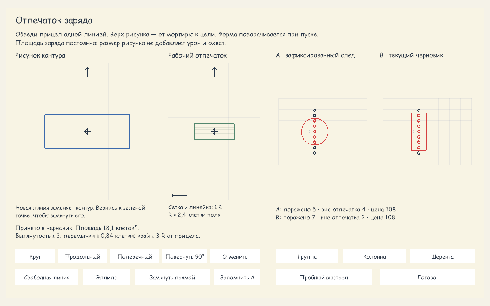
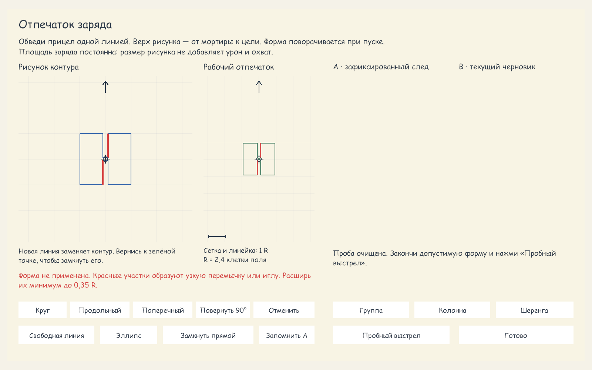

# Проверка второго этапа: «Отпечаток заряда»

Дата: 15 октября 2026. Unity 6000.5.7f1. Изменения первого этапа сохранены.

## Реальный интерфейс

Снимки получены из `MortarFootprintPanel` на Canvas 1600×1000, со штатным шрифтом NotebookHand и реальным `RunController.CompareMortarFootprints`. Изолированная временная сцена закрыта после съёмки, профиль пользователя не записывался.

Поперечный контур поражает 7 из 9 целей в шеренге; круг — 5 из 9. Площадь обоих зарядов 18,1 клетки², цена башни 108. Направление в пробе горизонтальное; поэтому поперечный рисунок развёрнут вертикально.

Узкая перемычка выделена на авторском и рабочем контурах. Ошибка поясняет минимальную ширину; старая запись очищена, предыдущая принятая форма сохранена.

## Проверки

- Красные → зелёные проверки нормализации, вогнутости, пересечений, перемычек, масштаба и поворота.
- Бой: квадрат поражает цель за пределами равного по площади круга; выемка вогнутой формы исключена; направление фиксируется при пуске; снаряд сохраняет контур после удаления/переоснащения башни.
- UI: настоящий жест мыши, ручное замыкание, ошибочный контур без старой записи, отмена, независимые мортиры, смена установки во время жеста, режим эллипса и восстановление контура.
- JSON: новая форма переживает реальное сохранение/загрузку, старый исходник не меняется, будущая версия защищает основной и резервный файлы.
- Независимое ревью выявило и помогло исправить несовпадающий числовой допуск вытянутости, переполнение координат показа и пропущенные рёбра пунктирного предвестника. Для каждого добавлена регрессия с воспроизведением ошибки.
- Python: 12 тестов прошли. Аудит новых пользовательских строк: 0 строк вне ресурсов.

Полные прогоны: **921/921 EditMode** (97,0 с) и **402/402 PlayMode** (87,7 с), без пропусков. Первый PlayMode-прогон выявил потерю пользовательской замены заголовка; прежний ключ ресурса сохранён, повторный полный прогон прошёл. Идентификаторы запусков и сводка — в [results.json](results.json).

Проверено в Unity Editor. Отдельная сборка плеера не создавалась.
