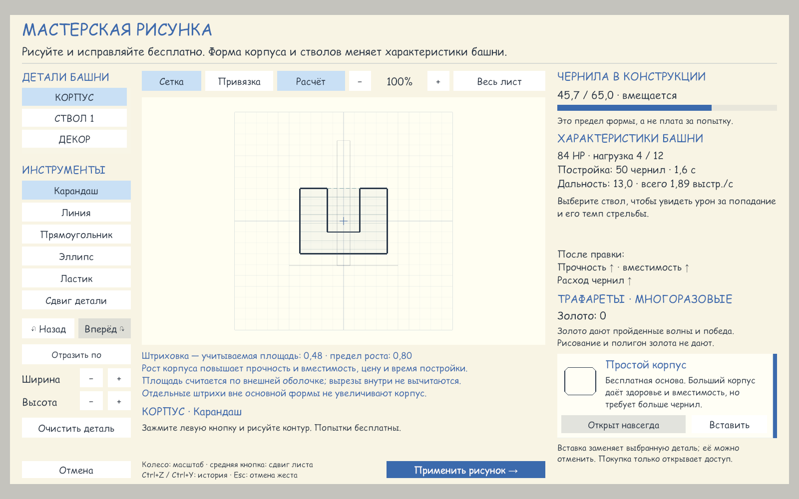
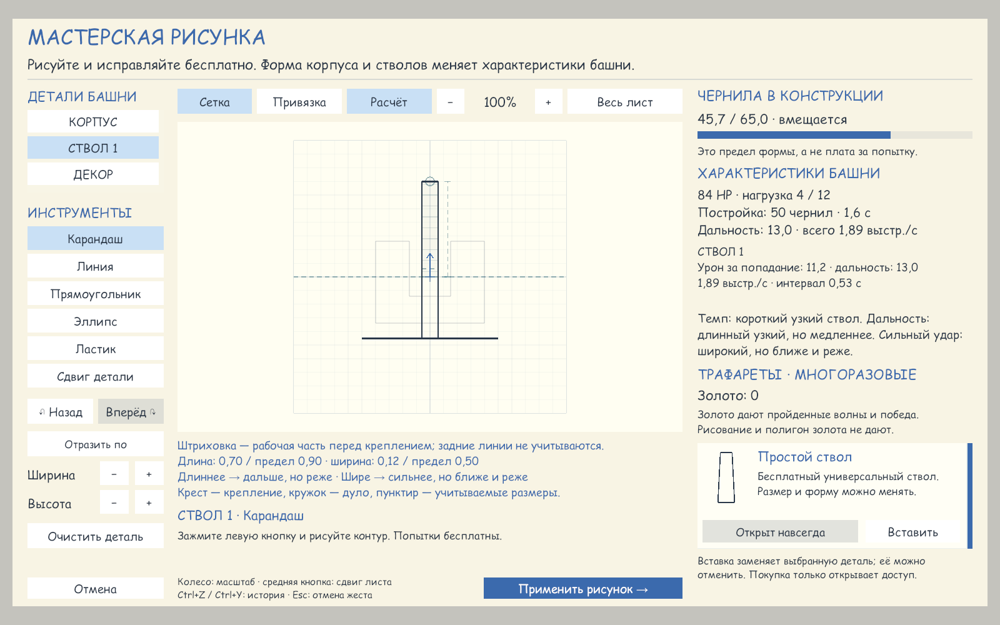

# Рабочая геометрия — проверка 15.10.2026

Первый этап: передняя рабочая часть ствола, общий расчёт для редактора и боя, отображение измерений и пределов роста. Базовая ревизия `04c8f81`; изменения оставлены в рабочем каталоге.

## Результаты

- EditMode: **906/906**, 0 ошибок и пропусков; job `1b98fe9f94264e1eaa880dc6422c1ab0`.
- PlayMode: **392/392**, 0 ошибок и пропусков; job `37e9a02fdb3d4bda83836419c4ac56eb`.
- Python: **12/12** (`Tools` — 4, `Tools/tests` — 8).
- Аудит новых текстов: 0 неизвлечённых строк. `git diff --check` без ошибок.
- Независимое ревью: оба замечания исправлены и повторно проверены; открытых замечаний нет.

## Проверенные случаи

Передний контур отсекается до определения связности. Заднее удлинение, перекладина и соединение двух передних частей через заднюю линию не увеличивают размеры или характеристики. Проверено соединение как разными штрихами, так и одним П-образным штрихом. Наклонный сегмент сохраняет точку пересечения с плоскостью крепления. Регрессионные тесты воспроизвели старые значения до исправлений.

Сохранённые правила v1 сохраняют старые размеры при загрузке и копировании; применение рисунка переводит копию на v2. Отмена не применяет переход. Проверены обновление размеров после правки/undo, округлённая вместимость в пояснении, неперекрытие областей UI, читаемость настоящего NotebookHand при масштабах 60% и 80%, включая сообщения обоих пределов.

## Визуальная проверка

Снимки 1600×1000 получены настоящим Unity UI в отдельной временной сцене с профилем в памяти. Камера, сцена и временный контроллер удалены после проверки, исходная сцена восстановлена. На корпусе с вырезом штриховка показывает учитываемую выпуклую оболочку; у ствола с задней перекладиной показаны рабочая часть, размеры и дуло.

Три исключения в Console относятся к успешным негативным тестам TextResourceIntegrationTests, намеренно подставляющим несовместимые текстовые шаблоны. Новых ошибок при захвате интерфейса нет. Отдельная сборка standalone Player не выполнялась.
