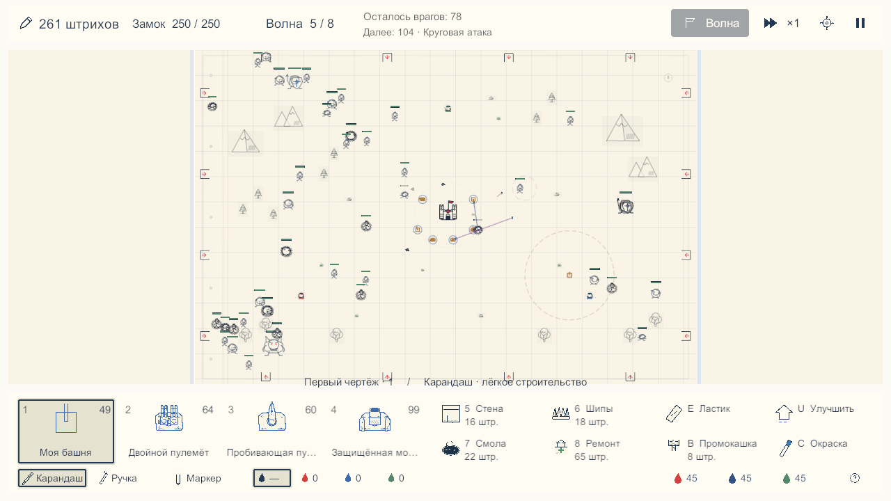
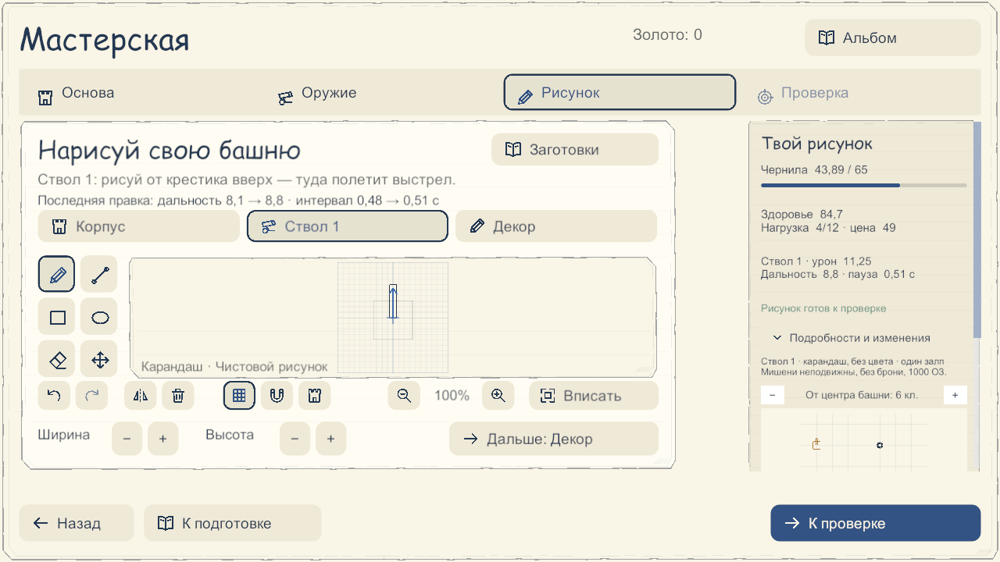

# Визуальное обновление: четыре этапа

Проверено 16 октября 2026 года в Unity 6000.5.7f1, исходная версия `ab60bf7`, игровая конфигурация `PlayerBalance → PlayerRules → PlayerContent`. Изменения выполнены в порядке: боевой экран → общая тема → башни, враги и эффекты → мастерская и остальные экраны.

## 1. Больше места бою

Верхняя строка содержит ресурсы, здоровье замка, волну, краткий прогноз и управление. Внизу четыре крупных чертежа, две компактные группы строительства и редактирования, материалы и чернила. Постоянная правая колонка заменена сведениями по щелчку на постройку и отдельной сводкой. Продолжение стены протягиванием от уже занятой клетки сохранено.

| Окно, масштаб UI 100% | Раньше: область мира | Теперь: область мира |
|---|---:|---:|
| 1280×720 | 36,5% | 65,4% |
| 1920×1080 | 51,5% | 75,0% |

Это доля viewport камеры, а не доля пикселей карты. Общий вид сохраняет пропорции карты; свободные поля по её бокам возможны. Масштаб 150% отдаёт больше места управлению, поэтому цель 65–75% относится к стандартному масштабу.

[Бой 1920×1080](combat-1920.png), [приближение 1,5×](combat-detail-1920.png), [интерфейс 150% и сведения о башне](battle-scale150-1280.png).

## 2. Общая бумага и состояния

Тёплый фон `#F9F4E6`, спокойные чернила, менее заметная сетка и единые поверхности используются в меню, мастерской и бою. Бумажные края оставлены на больших листах; мелкие элементы имеют простую форму. Выбранные элементы получают контур. Недостаток штрихов поясняется текстом, недоступные страницы альбома обозначены причиной. Длинные подписи сокращаются по фактической ширине шрифта; полное название доступно в подсказке. Рукописные заголовки и обычный рабочий шрифт сохранены. Основная игровая сцена включает эту тему.

## 3. Рисунок и события боя

Авторская геометрия не заменяется готовым спрайтом. Линии проявляются по действительному прогрессу строительства; готовность отмечается коротким контуром. Крепление оружия подчёркнуто, наведение и отдача остаются привязанными к конкретному стволу. У бегуна, громилы и щитоносца усилены различия пропорций. Окружение приглушено относительно боевых объектов.

Следы прямого, пробивающего и веерного оружия различаются толщиной и движением. Попадание имеет меньший акцент. Стирание и завершение строительства получили отдельные события; след ластика отличается от разрушения. Реальная форма попадания мортиры сохранена.

Снимки боя используют сохранённый через мастерскую рисунок: прямоугольный корпус и вытянутый игроком ствол. Он назначен в первый слот и построен рядом с обычными башнями. В тестовом профиле в памяти выбрана пятая волна существующих PlayerRules; затем выполнено 540 настоящих тактов боя после 180 тактов подготовки. На кадре — 41 живой враг всех шести семейств, шесть башен и замок с 250 HP. Переход к пятой волне — настройка проверочного сценария, не прохождение первых четырёх волн. Баланс и пользовательский профиль на диске не менялись.

## 4. Мастерская, меню и подготовка

Меню показывает большой чертёж из текущего набора рядом с замком. Карта сохраняет фактический рельеф, входы и источники. «Заменить чертёж» открывает альбом: выбор явный, отмена сохраняет набор, занятые страницы недоступны, клавиатурный фокус удерживается внутри окна.

Последствия последней правки вынесены над рисунком: на примере увеличение длины ствола меняет дальность с 8,1 до 8,8 и интервал с 0,48 до 0,51 секунды. Выбранная деталь сохраняет акцент, рабочая геометрия включается отдельно и имеет текстовый статус. Мини-проба рисует саму башню из записанных кадров симуляции, сохраняя действительную форму поражения.

[Меню](home-1280.png), [меню с авторской башней](home-authored-1280.png), [разведка](map-1280.png), [подготовка](preparation-1280.png), [выбор страницы](album-1280.png), [рисунок 1920×1080](drawing-1920.png), [мини-проба](drawing-probe-1920.png).

## Проверки и воспроизведение

- **EditMode: 58/58.** `VisualEventMetadataTests`, `GameSessionTests`, `PlayerSceneTests`, `ConstructionRulesTests`. [Результат](editmode-results.json).
- **PlayMode: 121/121.** `PlayerLayoutTests`, `PlayerJourneyTests`, `AuthoredRenderingTests`, `NotebookAnimationRenderingTests`, `NotebookCameraReadabilityTests`, `DrawingProbePanelTests`, `GuidedDrawingPanelTests`, `WorkshopUiTests`, `WorkshopReadabilityTests`, `DrawingRangeStateTests`, `ConstructionBoundaryTests`, `ConstructionRulesIntegrationTests`, `MortarFootprintRenderingTests`. [Результат](playmode-results.json).
- Новые проверки покрывают долю viewport, явный выбор страницы и блокировку закрытых окном кнопок, щелчок и продолжение стены, отдельное событие стирания, однократное завершение строительства и сохранение исходной геометрии после проявления линий.
- Снимки сделаны `FullGameUiCapture` / `PlayerVisualCapture` из настоящих камеры и Canvas в Play Mode. Для этого `FullGameUiCapture.Folder` направлен в текущую папку. Профиль создавался с `memoryOnly=true`, симуляция управлялась явно.
- Рядом с каждым PNG сохранён `*-text-check.txt`: проверяется превышение `preferredHeight` над высотой поля. В окончательных кадрах эти файлы пусты. Дополнительно визуально проверены подписи, модальный выбор, редактор и контекст при масштабе 150%.
- Проверка кода выявила и помогла исправить перехват продолжения стены, прокрутку контекста и клавиатурный фокус альбома. Снимки выявили и помогли исправить наложение строки последней правки и длинных подписей.

Для обычного запуска: **Paper Defense → Game → Open player game**, затем Play. Windows Player в рамках этого обновления не собирался; проверены редактор и перечисленные тесты, не весь набор тестов проекта. Редактор после проверки возвращён к исходной сцене `27_PlayerAssets`.
